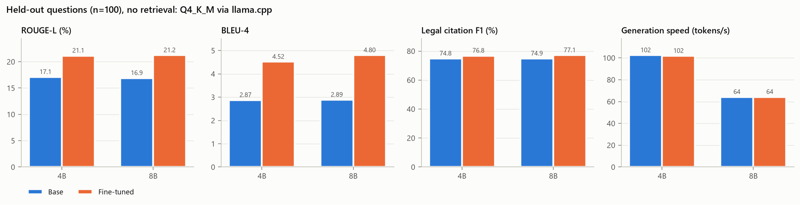
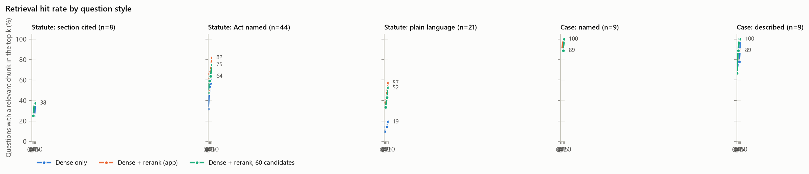
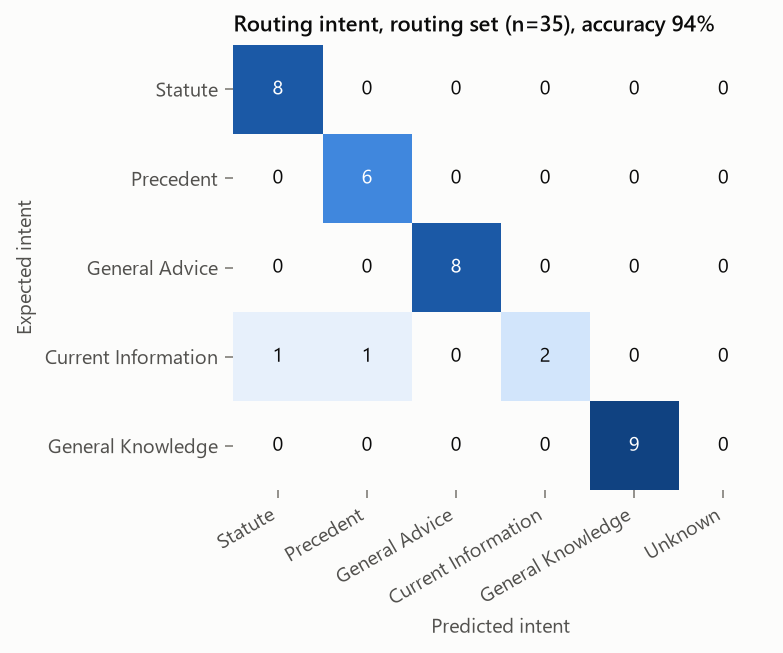
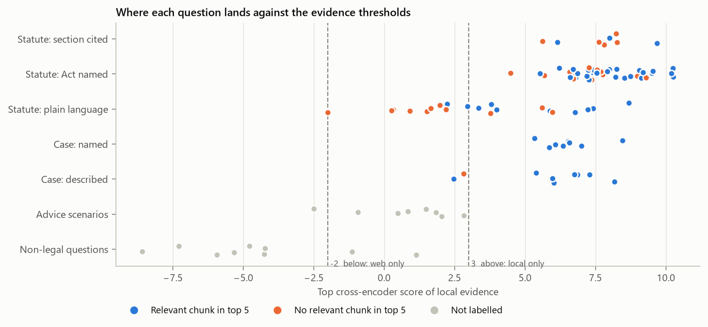
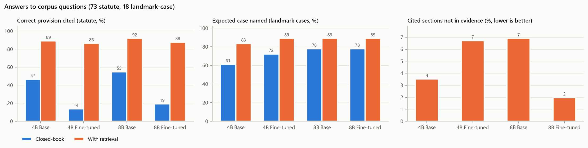

# Evaluation report

Run 2026-10-27 21:06:45 to 2026-10-27 22:52:34 on NVIDIA GeForce RTX 5060 Laptop GPU (full run), llama.cpp version: 0.7.0-dev (build 11836, commit f5027fb21), context 8192, seed 42. Generated by `notebooks/evaluation.ipynb`; per-question data in the CSVs next to this file.

## 1. Model quality without retrieval (100 held-out questions)

| index | rouge_1 | rouge_2 | rouge_l | bleu_4 | citation_f1 | legal_terms | gen_tok_s | latency_s |
|---|---|---|---|---|---|---|---|---|
| 4B Base | 28.05 | 9.75 | 17.09 | 2.87 | 74.85 | 0.71 | 102.42 | 1.98 |
| 4B Fine-tuned | 32.22 | 15.05 | 21.14 | 4.52 | 76.79 | 0.45 | 101.81 | 1.81 |
| 8B Base | 28.10 | 9.90 | 16.89 | 2.89 | 74.86 | 0.79 | 64.13 | 3.15 |
| 8B Fine-tuned | 32.22 | 15.28 | 21.23 | 4.80 | 77.11 | 0.55 | 64.20 | 2.82 |

Fine-tuned minus base (95% paired bootstrap interval):

| size | metric | base | fine_tuned | difference | ci95_low | ci95_high | significant |
|---|---|---|---|---|---|---|---|
| 4B | rouge_1 | 28.05 | 32.22 | 4.17 | 2.72 | 5.51 | True |
| 4B | rouge_2 | 9.75 | 15.05 | 5.31 | 4.29 | 6.28 | True |
| 4B | rouge_l | 17.09 | 21.14 | 4.05 | 2.98 | 5.05 | True |
| 4B | bleu_4 | 2.87 | 4.52 | 1.64 | 1.05 | 2.25 | True |
| 4B | citation_f1 | 74.85 | 76.79 | 1.94 | -3.19 | 7.22 | False |
| 4B | legal_terms | 0.71 | 0.45 | -0.26 | -0.50 | -0.03 | True |
| 8B | rouge_1 | 28.10 | 32.22 | 4.11 | 2.25 | 5.93 | True |
| 8B | rouge_2 | 9.90 | 15.28 | 5.38 | 3.98 | 6.70 | True |
| 8B | rouge_l | 16.89 | 21.23 | 4.33 | 3.03 | 5.68 | True |
| 8B | bleu_4 | 2.89 | 4.80 | 1.91 | 0.98 | 2.92 | True |
| 8B | citation_f1 | 74.86 | 77.11 | 2.25 | -2.28 | 6.95 | False |
| 8B | legal_terms | 0.79 | 0.55 | -0.24 | -0.58 | 0.08 | False |

Difference from the bf16 HPC reference (FINETUNING_INFO.md, section 8):

| model | bleu_4 | citation_f1 | citation_recall | rouge_1 | rouge_2 | rouge_l |
|---|---|---|---|---|---|---|
| 4B Base | 0.13 | -1.12 | -1.37 | 0.71 | 0.42 | 0.23 |
| 4B Fine-tuned | 0.18 | 0.19 | 1.16 | 0.33 | 0.51 | 0.35 |
| 8B Base | -0.01 | -1.33 | -0.26 | 0.70 | 0.38 | 0.04 |
| 8B Fine-tuned | 0.69 | 2.51 | 3.73 | 0.89 | 1.30 | 0.69 |

## 2. Retrieval

| questions | n | system | Hit@1 | Hit@3 | Hit@5 | Hit@10 | MRR@10 | in_pool_% |
|---|---|---|---|---|---|---|---|---|
| All corpus questions | 91 | Dense only | 35.16 | 46.15 | 49.45 | 57.14 | 0.42 | 84.62 |
| All corpus questions | 91 | Dense + rerank (app) | 50.55 | 60.44 | 65.93 | 74.73 | 0.57 | 84.62 |
| All corpus questions | 91 | Dense + rerank, 60 candidates | 48.35 | 56.04 | 62.64 | 71.43 | 0.55 | 89.01 |
| Statute: section cited | 8 | Dense only | 25.00 | 25.00 | 25.00 | 37.50 | 0.27 | 50.00 |
| Statute: section cited | 8 | Dense + rerank (app) | 25.00 | 25.00 | 37.50 | 37.50 | 0.28 | 50.00 |
| Statute: section cited | 8 | Dense + rerank, 60 candidates | 25.00 | 25.00 | 37.50 | 37.50 | 0.28 | 50.00 |
| Statute: Act named | 44 | Dense only | 31.82 | 50.00 | 56.82 | 63.64 | 0.42 | 93.18 |
| Statute: Act named | 44 | Dense + rerank (app) | 50.00 | 65.91 | 68.18 | 81.82 | 0.59 | 93.18 |
| Statute: Act named | 44 | Dense + rerank, 60 candidates | 47.73 | 59.09 | 63.64 | 75.00 | 0.55 | 97.73 |
| Statute: plain language | 21 | Dense only | 9.52 | 14.29 | 14.29 | 19.05 | 0.12 | 66.67 |
| Statute: plain language | 21 | Dense + rerank (app) | 38.10 | 38.10 | 47.62 | 57.14 | 0.42 | 66.67 |
| Statute: plain language | 21 | Dense + rerank, 60 candidates | 33.33 | 33.33 | 42.86 | 52.38 | 0.37 | 76.19 |
| Case: named | 9 | Dense only | 88.89 | 88.89 | 88.89 | 88.89 | 0.89 | 100.00 |
| Case: named | 9 | Dense + rerank (app) | 88.89 | 88.89 | 100.00 | 100.00 | 0.92 | 100.00 |
| Case: named | 9 | Dense + rerank, 60 candidates | 88.89 | 88.89 | 88.89 | 100.00 | 0.90 | 100.00 |
| Case: described | 9 | Dense only | 66.67 | 77.78 | 77.78 | 100.00 | 0.73 | 100.00 |
| Case: described | 9 | Dense + rerank (app) | 66.67 | 88.89 | 88.89 | 88.89 | 0.76 | 100.00 |
| Case: described | 9 | Dense + rerank, 60 candidates | 66.67 | 88.89 | 100.00 | 100.00 | 0.81 | 100.00 |

## 3. Routing and drafting

| expected_intent | n | intent_acc | source_acc | llm_fallback |
|---|---|---|---|---|
| CURRENT_INFORMATION | 4 | 50.00 | 50.00 | 25.00 |
| GENERAL_ADVICE | 8 | 100.00 | 100.00 | 12.50 |
| GENERAL_KNOWLEDGE | 9 | 100.00 | 100.00 | 33.33 |
| PRECEDENT | 6 | 100.00 | 100.00 | 0.00 |
| STATUTE | 8 | 100.00 | 100.00 | 0.00 |

| index | value |
|---|---|
| routing_set_n | 35.00 |
| intent_accuracy_% | 94.29 |
| source_accuracy_% | 94.29 |
| corpus_decision_accuracy_% | 100.00 |
| corpus_questions_searched_corpus_% | 100.00 |
| llm_fallback_% | 5.56 |
| median_ms_fast_path | 0.00 |
| median_ms_llm_path | 2371.00 |

Drafting requests:

| set | n | detected_pct | correct_format_pct |
|---|---|---|---|
| paraphrase | 4.00 | 50.00 | 50.00 |
| readme | 15.00 | 100.00 | 100.00 |
| false positives (non-drafting questions) | 126.00 | 0.79 |  |

## 4. Evidence thresholds

| group | local + web | local only (>= 3) | web only (< -2) |
|---|---|---|---|
| Advice scenarios | 7 | 0 | 1 |
| Case: described | 2 | 7 | 0 |
| Case: named | 0 | 9 | 0 |
| Non-legal questions | 2 | 0 | 7 |
| Statute: Act named | 0 | 44 | 0 |
| Statute: plain language | 10 | 11 | 0 |
| Statute: section cited | 0 | 8 | 0 |

## 5. End-to-end answers

| model | condition | correct_provision_% | correct_provision_when_evidence_has_it_% | act_named_% | case_named_% | citations_not_in_evidence_% | answer_tokens | latency_s | hit_max_tokens_% |
|---|---|---|---|---|---|---|---|---|---|
| 4B Base | Closed-book | 46.58 | 48.84 | 82.19 | 61.11 |  | 682.31 | 7.10 | 50.55 |
| 4B Base | With retrieval | 89.04 | 100.00 | 94.52 | 83.33 | 3.52 | 753.60 | 9.17 | 83.52 |
| 4B Fine-tuned | Closed-book | 13.70 | 9.30 | 68.49 | 72.22 |  | 268.89 | 2.83 | 0.00 |
| 4B Fine-tuned | With retrieval | 86.30 | 97.67 | 91.78 | 88.89 | 6.72 | 474.00 | 5.90 | 0.00 |
| 8B Base | Closed-book | 54.79 | 55.81 | 84.93 | 77.78 |  | 640.44 | 10.33 | 32.97 |
| 8B Base | With retrieval | 91.78 | 100.00 | 97.26 | 88.89 | 6.90 | 754.87 | 13.90 | 82.42 |
| 8B Fine-tuned | Closed-book | 19.18 | 16.28 | 69.86 | 77.78 |  | 288.88 | 4.72 | 0.00 |
| 8B Fine-tuned | With retrieval | 87.67 | 95.35 | 95.89 | 88.89 | 1.97 | 629.26 | 11.73 | 37.36 |

Correct provision by question style (%):

| label | condition | act | plain | section |
|---|---|---|---|---|
| 4B Base | Closed-book | 45.45 | 28.57 | 100.00 |
| 4B Base | With retrieval | 93.18 | 76.19 | 100.00 |
| 4B Fine-tuned | Closed-book | 6.82 | 4.76 | 75.00 |
| 4B Fine-tuned | With retrieval | 93.18 | 66.67 | 100.00 |
| 8B Base | Closed-book | 61.36 | 23.81 | 100.00 |
| 8B Base | With retrieval | 97.73 | 76.19 | 100.00 |
| 8B Fine-tuned | Closed-book | 13.64 | 4.76 | 87.50 |
| 8B Fine-tuned | With retrieval | 95.45 | 66.67 | 100.00 |

## Method notes

- All local generation uses the deployed Q4_K_M GGUFs through llama-server, temperature 0.2, top-p 0.9, repetition penalty 1.1, fixed seed. Part 1 answers are capped at 200 tokens like the reference benchmark; part 5 at 768 (the app allows 1500).
- Overlap metrics (ROUGE, BLEU, citation F1) are computed with the reference benchmark's code (`to_finetune/evaluate.py`).
- Statute targets were verified against the index; landmark-case relevance is a text match on case name plus subject keyword, so a chunk that only cites the case counts.
- 'Correct provision' needs both the section number and the Act in the answer; 'citations not in evidence' is a regex proxy and can flag sections the model cited correctly from memory.
- Web search is not used anywhere; part 5 measures the local corpus only.
